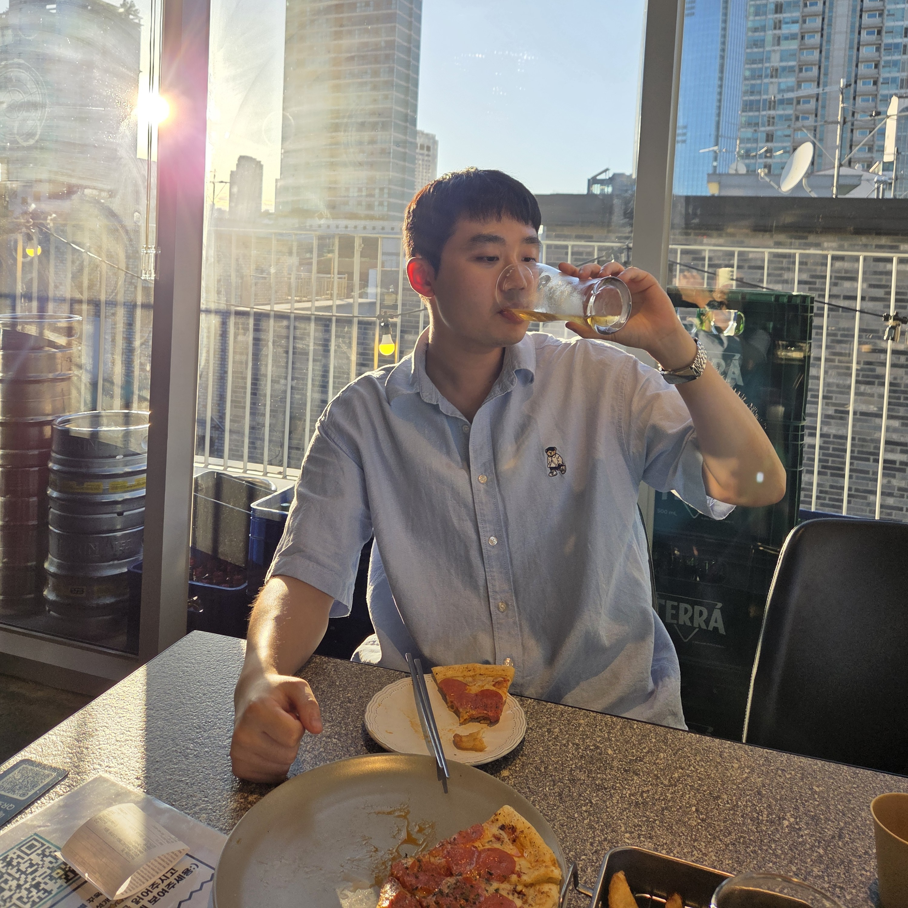

I am an undergraduate student in the Department of Mechanical Engineering at [Yonsei University](https://www.yonsei.ac.kr/), South Korea.

My interests lie in automotive engineering, with a particular focus on control systems. I am interested in how vehicles can be controlled to move safely, efficiently, and reliably, and I aim to build a strong foundation in both the theory and hands-on implementation of vehicle control.

**Research Interests:** Control Systems, Automotive Engineering

**Email:** noh708@naver.com

Seoul, South Korea

## Education

| Mar. 2023 - Feb. 2029 (Expected) | [Yonsei University](https://www.yonsei.ac.kr/), Seoul, South Korea B.S. in Mechanical Engineering *Leave of absence for military service (May 2024 - Jan. 2026)* |

## Military Service

| May 2024 - Jan. 2026 | Republic of Korea Air Force (ROKAF) *Sergeant, Honorably Discharged* Aircraft Tow Tractor Operator Operated aircraft tow tractors for aircraft towing and ground handling operations. |

## Competitions

|    **3D Design for Future Competition** — *Participated* **Participants:** Hyunseung Noh (Team Leader), Younghyun Kim Korea Productivity Center (KPC), 2026 Sponsored by Ministry of Trade, Industry and Resources, Autodesk Designed a modular EV platform that supports both a sedan and a truck body using Fusion 360. Responsible for the in-wheel motor (rotor/stator) and wheel hub design, generative design of the upper arm, steering arm and frame, an electrically actuated multi-pin coupling mechanism, and the sedan body form design. |

## Licenses & Certifications

- Class 1 Large Driver's License (Korea)
- Class 1 Ordinary Driver's License (Korea)
- Class 2 Ordinary Driver's License (Korea)
