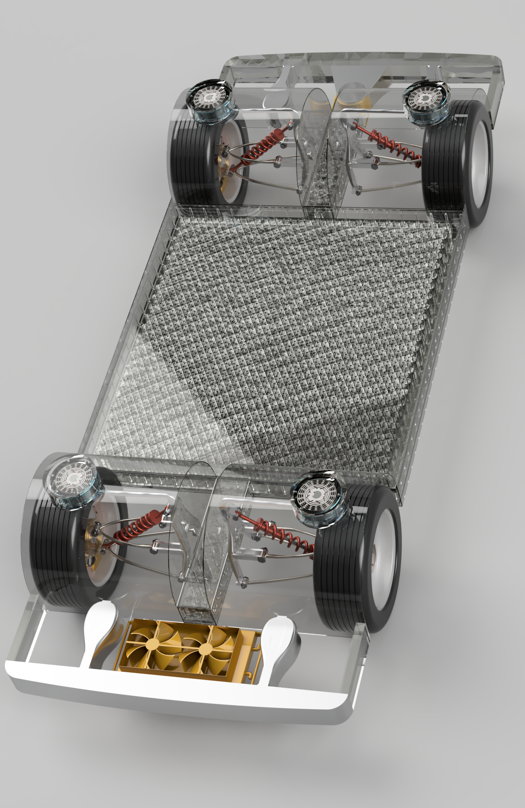
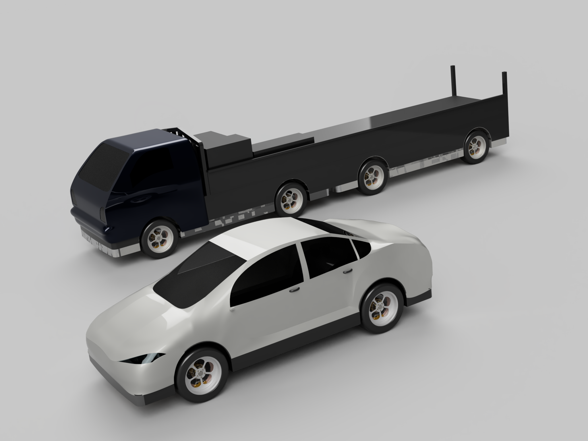

I am an undergraduate student in the Department of Mechanical Engineering at [Yonsei University](https://www.yonsei.ac.kr/), South Korea.

My interests lie in automotive engineering, with a particular focus on control systems. I am interested in how vehicles can be controlled to move safely, efficiently, and reliably, and I aim to build a strong foundation in both the theory and hands-on implementation of vehicle control.

**Research Interests:** Control Systems, Automotive Engineering

**Email:** noh708@naver.com
## Education

| Mar. 2023 - Present | [Yonsei University](https://www.yonsei.ac.kr/), Seoul, South Korea B.S. in Mechanical Engineering |

## Experience

| 2026 - Present | 활동/동아리 이름 *역할* 한 줄 설명 |

## Projects

|  **F1TENTH Autonomous Racing** **Participants:** Hyunseung Noh, ... 한두 줄 설명 |

## Competitions

|    **3D Design for Future Competition** — *Participated* **Participants:** Hyunseung Noh (Team Leader), Younghyun Kim 주최 기관, 2026 Designed a modular EV platform that supports both a sedan and a truck body using Fusion 360. Responsible for the in-wheel motor (rotor/stator) and wheel hub design, generative design of the upper arm, steering arm and frame, an electrically actuated multi-pin coupling mechanism, and the sedan body form design. |

## Honors and Awards

🏆 **수상 이름**
- 등수
- (Month, Year) From 주최 기관
